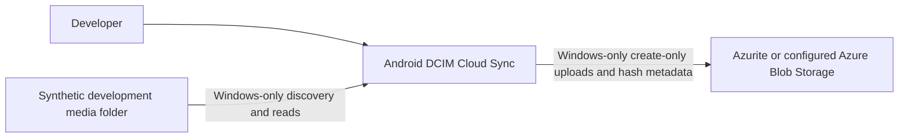

# Android DCIM Cloud Sync

Android DCIM Cloud Sync is a .NET 10 MAUI learning project for a photo and video backup application.
Android is the product platform. A Windows target exists so services can be developed and debugged on
a workstation before they are tried on a phone. Backup works only from the Windows development target
today.

## Current Application

The app opens one scrollable **Status** page.

- **Android 13 or later:** the page adds **Scan media**. On first use Android asks for photo and video
  access; the scan then reads the DCIM photos and videos the user allows, with their original bytes and
  location, and reports the same totals as on Windows. Selecting only some photos limits the scan to
  those, and the result says so. There is no **Back up** button on Android yet.
- **Windows (development only):** the page adds a **Media** section that reads a local folder standing
  in for the phone's DCIM collection.
  - **Scan media** computes a SHA-256 hash of each photo and video and reports the item count, bytes
    read, duplicates and unreadable files.
  - **Back up** appears when a backup destination is configured. It copies each item to Azure Blob
    Storage once, records its SHA-256 as blob metadata and never overwrites or deletes anything. A
    rerun uploads only missing items and reports existing backups whose hash matches, differs
    (conflict) or is absent (unverified). A file edited during its upload is abandoned before commit
    and retried by the next run.

Android backup, device credentials, background scheduling, retries and deletion are not implemented.

| Project | Purpose |
| --- | --- |
| [DcimCloudSync](src/DcimCloudSync/README.md) | MAUI application for Android, plus the Windows development target |
| [DcimCloudSync.Core](src/DcimCloudSync.Core/README.md) | Platform-neutral media and backup contracts, folder media source, scan and backup services |
| [DcimCloudSync.Storage.Azure](src/DcimCloudSync.Storage.Azure/README.md) | Azure Blob Storage backup destination built on `CasCap.Api.Azure.Storage` |
| [DcimCloudSync.Core.Tests](src/DcimCloudSync.Core.Tests/README.md) | Unit tests for the core library |
| [DcimCloudSync.Storage.Azure.Tests](src/DcimCloudSync.Storage.Azure.Tests/README.md) | Naming unit tests and Azurite integration tests for the Azure destination |

## System Context



The Android page remains static. The Windows development target is the only runtime that reads
media or uploads backups. See the [architecture, dependencies and validation flow](docs/architecture.md).

## Local Development

Use a stable .NET SDK compatible with `global.json` (`10.0.403`, with `latestFeature` roll-forward
and prereleases disabled) and the .NET MAUI Android workload with its matching Android SDK and JDK.
Install the workload from an elevated prompt in the repository root so `global.json` selects the SDK:

```powershell
dotnet workload install maui-android
```

Visual Studio 2026 with MAUI tooling is the interactive development path. Debug builds reference the
`CasCap.Api.Azure.Storage` source in a sibling `CasCap.Api.Azure` checkout, which in turn expects a
sibling `CasCap.Common` checkout; clone both next to this repository. Build every project from the
repository root:

```powershell
dotnet build .\android-dcim-cloud-sync.slnx --configuration Debug
```

On Windows this builds both the Android and Windows targets; on other operating systems only the
Android target is built. Release builds use the published `CasCap.Api.Azure.Storage` **2.0.0**,
including create-only uploads and metadata lookup; no sibling checkout is required for Release.

```powershell
dotnet build .\android-dcim-cloud-sync.slnx --configuration Release
```

### Continuous Integration

[CI](.github/workflows/ci.yml) produces unsigned Android validation bundles and a self-contained,
unpackaged Windows development artifact named `DcimCloudSync-windows-x64-<version>`, kept for
14 days. Download it from the run's **Artifacts** section, extract it and start `DcimCloudSync.exe`;
no .NET or Windows App SDK install is needed. These are test artifacts, not signed or distributed
product releases. See the [validation flow](docs/architecture.md#validation-flow).

### Local Azure Storage

[docker-compose.yml](docker-compose.yml) runs Azurite, the Azure Storage emulator. No Azure account
is needed; the Compose file owns its listener and storage configuration:

```powershell
docker compose up -d --wait azurite
docker compose down            # stop; add --volumes to discard emulator data
```

### Debug on Windows

Debug services on Windows first; switch to Android only for a deliberate device test.

1. Put synthetic or copied test photos and videos in `Pictures\DcimCloudSync`. Subfolders are
   scanned. Do not use media you would not want read by development builds.
2. To use another folder, set the `DcimCloudSync__FileSystemMediaSource__RootPath` user environment
   variable.
3. To enable **Back up** against Azurite, set these user environment variables:

   ```powershell
   [Environment]::SetEnvironmentVariable('DcimCloudSync__AzureBlobBackup__ConnectionString', 'UseDevelopmentStorage=true', 'User')
   [Environment]::SetEnvironmentVariable('DcimCloudSync__AzureBlobBackup__ContainerCreationEnabled', 'true', 'User')
   ```

   The [Azure destination README](src/DcimCloudSync.Storage.Azure/README.md#configuration) lists every
   setting. Never point a development build at a production account.
4. Restart Visual Studio so the app inherits the variables. Select the `net10.0-windows10.0.19041.0`
   framework and the **Windows Machine** target, then start debugging. The app runs unpackaged.
5. Select **Scan media** or **Back up**. Debug output shows summaries; it never includes file names or
   paths.

### Debug on Android

Select a compatible Android emulator or a paired device in Visual Studio and deploy interactively, or
from the command line with
`dotnet build .\src\DcimCloudSync\DcimCloudSync.csproj -t:Run -f net10.0-android`.
An Android emulator avoids enabling developer options on a managed phone. On an emulator, add
synthetic photos to DCIM by dragging files onto the emulator window or with
`adb push <file> /sdcard/DCIM/Camera/`, then rescan them with
`adb shell content call --method scan_volume --uri content://media --arg external_primary`. To see the
permission prompt again, for example to test **Allow limited access** or **Don't allow**, reset the
app's permissions with `adb shell pm reset-permissions -p io.github.f2calv.androiddcimcloudsync`.

### Tests

Unit tests need only the local machine: no device, Android SDK, network or cloud resources.

```powershell
dotnet test --project .\src\DcimCloudSync.Core.Tests\DcimCloudSync.Core.Tests.csproj
dotnet test --project .\src\DcimCloudSync.Storage.Azure.Tests\DcimCloudSync.Storage.Azure.Tests.csproj --filter-not-trait Category=Integration
```

Integration tests upload to Azurite in disposable per-test containers and skip when it is not
running. Start Azurite first, then omit the filter:

```powershell
docker compose up -d --wait azurite
dotnet test --project .\src\DcimCloudSync.Storage.Azure.Tests\DcimCloudSync.Storage.Azure.Tests.csproj
```

There are no UI automation tests; the page is validated interactively.

## Privacy and Platform Limits

On Android the app reads DCIM photos and videos only when the user starts a scan, keeps the results in
memory, stores no credentials or backup state, and sends no product data off the device. Its
[Android manifest](src/DcimCloudSync/Platforms/Android/AndroidManifest.xml) declares:

| Permission | Scope in this checkout |
| --- | --- |
| `android.permission.READ_MEDIA_IMAGES` | Reads photos for the scan |
| `android.permission.READ_MEDIA_VIDEO` | Reads videos for the scan |
| `android.permission.READ_MEDIA_VISUAL_USER_SELECTED` | Android 14 and later: lets the user allow only selected photos and videos |
| `android.permission.ACCESS_MEDIA_LOCATION` | Reads photos with their location metadata intact, so a future backup keeps it; it shows no prompt of its own |
| `android.permission.INTERNET` | Allows network access; the Android app makes no network requests yet |
| `android.permission.ACCESS_NETWORK_STATE` | Allows connectivity inspection; the Android app does not inspect it yet |

The app requests these only when **Scan media** is selected. When access is denied, it opens the
app's settings instead of asking repeatedly. Location stays inside the photo bytes the app reads; it
is never extracted, shown or logged. No broad storage, notification or background-service
permissions are declared. Android
application-data backup is disabled and cleartext traffic is disallowed. No background worker
survives closing the app.

The Windows target reads files only from the configured folder and sends them only to the configured
backup destination. Its connection string comes from an environment variable and is never stored by
the app. Uploads are create-only: nothing is overwritten or deleted, locally or remotely. The Windows
target is not distributed. iOS and macOS are not targeted.

See the [security policy](SECURITY.md) for vulnerability reporting.

## License

[MIT](LICENSE).
