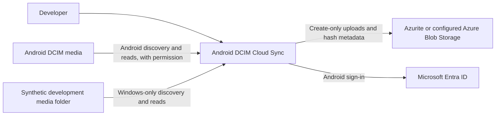

# Android DCIM Cloud Sync

Android DCIM Cloud Sync is a .NET 10 MAUI app, in development preview, that backs up the photos and
videos on an Android phone to the owner's Azure Blob Storage container. It signs in with the owner's
Microsoft account, uploads each file once, never overwrites or deletes, and can back up new media in the
background. Android is the product platform. A Windows target exists so services can be developed and
debugged on a workstation before they are tried on a phone.

## Current Application

The app opens on a **Status** page, with a **Log** tab and, on Android, a **Settings** tab.

- **Android 13 or later:** the page adds **Scan media**. On first use Android asks for photo and video
  access; the scan then reads the photos and videos in the camera folder, `DCIM/Camera`, that the user
  allows, with their original bytes and location, and reports the same totals as on Windows. Other DCIM
  folders, such as those other apps create, are skipped unless **Also back up other DCIM folders** is
  on in **Settings**. Selecting only some photos limits the scan to those, and the result says so.
  **Back up** appears once the **Settings** tab holds the storage and sign-in details; the first backup
  opens a Microsoft sign-in in the browser, after which tokens refresh
  silently. Backups follow the same create-only rules as on Windows. While **automatic backup** is on in
  **Settings**, new DCIM photos and videos are also backed up in the background on Wi-Fi, and a short
  notification summarises each run that backs something up.
- **Both targets:** while a backup runs, the page names the current file and shows how much of it has been
  read or uploaded, so a large video visibly progresses. The **Log** tab lists the 25 most recent scan
  and backup events with file names and sizes, newest first. **Settings** on Android, or
  `DcimCloudSync__Backup__CheckMode` on Windows, selects the already-backed-up check:
  - **Quick**, the default, skips an existing backup whose recorded size and modified time match the
    file, without reading it.
  - **Full** reads every file and compares its SHA-256.

  Every upload records its SHA-256 either way.
- **Windows (development only):** the page adds a **Media** section that reads a local folder standing
  in for the phone's DCIM collection.
  - **Scan media** computes a SHA-256 hash of each photo and video and reports the item count, bytes
    read, duplicates and unreadable files.
  - **Back up** appears when a backup destination is configured. It copies each item to Azure Blob
    Storage once, records its SHA-256 as blob metadata and never overwrites or deletes anything. A
    rerun uploads only missing items and reports existing backups whose hash matches, differs
    (conflict) or is absent (unverified). A file edited during its upload is abandoned before commit
    and retried by the next run.

Deletion is not implemented, and background backup exists only on Android.

| Project | Purpose |
| --- | --- |
| [DcimCloudSync](src/DcimCloudSync/README.md) | MAUI application for Android, plus the Windows development target |
| [DcimCloudSync.Core](src/DcimCloudSync.Core/README.md) | Platform-neutral media and backup contracts, folder media source, scan and backup services |
| [DcimCloudSync.Storage.Azure](src/DcimCloudSync.Storage.Azure/README.md) | Azure Blob Storage backup destination built on `CasCap.Api.Azure.Storage` |
| [DcimCloudSync.Core.Tests](src/DcimCloudSync.Core.Tests/README.md) | Unit tests for the core library |
| [DcimCloudSync.Storage.Azure.Tests](src/DcimCloudSync.Storage.Azure.Tests/README.md) | Naming unit tests and Azurite integration tests for the Azure destination |

## System Context



Android reads DCIM media and uploads backups after a Microsoft sign-in, as decided in
[ADR 0001](docs/adr-0001-device-credentials.md); the Windows development target uploads with a configured
connection string. See the [architecture, dependencies and validation flow](docs/architecture.md).

## Local Development

Use a stable .NET SDK compatible with `global.json` (`10.0.403`, with `latestFeature` roll-forward
and prereleases disabled) and the .NET MAUI Android workload with its matching Android SDK and JDK.
Install the workload from an elevated prompt in the repository root so `global.json` selects the SDK:

```powershell
dotnet workload install maui-android
```

Visual Studio 2026 with MAUI tooling is the interactive development path. Debug builds reference the
`CasCap.Api.Azure.Storage` source in a sibling `CasCap.Api.Azure` checkout, which in turn expects a
sibling `CasCap.Common` checkout; clone both next to this repository. Build every project from the
repository root:

```powershell
dotnet build .\android-dcim-cloud-sync.slnx --configuration Debug
```

On Windows this builds both the Android and Windows targets; on other operating systems only the
Android target is built. Release builds use the published `CasCap.Api.Azure.Storage` **2.0.0**,
including create-only uploads and metadata lookup; no sibling checkout is required for Release.

```powershell
dotnet build .\android-dcim-cloud-sync.slnx --configuration Release
```

### Continuous Integration

[CI](.github/workflows/ci.yml) produces unsigned Android validation bundles and a self-contained,
unpackaged Windows development artifact named `DcimCloudSync-windows-x64-<version>`, kept for
14 days. Download it from the run's **Artifacts** section, extract it and start `DcimCloudSync.exe`;
no .NET or Windows App SDK install is needed. On `main` and same-repository pull requests, CI also
builds `android-apk-<version>`, a sideload APK [signed with the sideload keystore](#build-an-apk-for-a-phone),
kept for 14 days. These are test artifacts, not release-signed or distributed product releases. See
the [validation flow](docs/architecture.md#validation-flow).

### Local Azure Storage

[docker-compose.yml](docker-compose.yml) runs Azurite, the Azure Storage emulator. No Azure account
is needed; the Compose file owns its listener and storage configuration:

```powershell
docker compose up -d --wait azurite
docker compose down            # stop; add --volumes to discard emulator data
```

### Debug on Windows

Debug services on Windows first; switch to Android only for a deliberate device test.

1. Put synthetic or copied test photos and videos in `Pictures\DcimCloudSync`. Subfolders are
   scanned. Do not use media you would not want read by development builds.
2. To use another folder, set the `DcimCloudSync__FileSystemMediaSource__RootPath` user environment
   variable.
3. To enable **Back up** against Azurite, set these user environment variables:

   ```powershell
   [Environment]::SetEnvironmentVariable('DcimCloudSync__AzureBlobBackup__ConnectionString', 'UseDevelopmentStorage=true', 'User')
   [Environment]::SetEnvironmentVariable('DcimCloudSync__AzureBlobBackup__ContainerCreationEnabled', 'true', 'User')
   ```

   The [Azure destination README](src/DcimCloudSync.Storage.Azure/README.md#configuration) lists every
   setting. Never point a development build at a production account.
4. Restart Visual Studio so the app inherits the variables. Select the `net10.0-windows10.0.19041.0`
   framework and the **Windows Machine** target, then start debugging. The app runs unpackaged.
5. Select **Scan media** or **Back up**. Debug output shows summaries; it never includes file names or
   paths.

### Debug on Android

Select a compatible Android emulator or a paired device in Visual Studio and deploy interactively, or
from the command line with
`dotnet build .\src\DcimCloudSync\DcimCloudSync.csproj -t:Run -f net10.0-android`.
An Android emulator avoids enabling developer options on a managed phone. On an emulator, add
synthetic photos to DCIM by dragging files onto the emulator window or with
`adb push <file> /sdcard/DCIM/Camera/`, then rescan them with
`adb shell content call --method scan_volume --uri content://media --arg external_primary`. To see the
permission prompt again, for example to test **Allow limited access** or **Don't allow**, reset the
app's permissions with `adb shell pm reset-permissions -p io.github.f2calv.androiddcimcloudsync`.

### Build an APK for a Phone

Debug deployments keep the app's code on the development machine, so they cannot be copied to a
phone. To sideload onto a phone without enabling debugging, build a Release APK:

```powershell
./build-apk.ps1                                 # writes artifacts/apk/android-dcim-cloud-sync-<version>-<code>.apk
./build-apk.ps1 -Install -Device emulator-5554  # also installs it over an earlier build on an emulator
```

On Linux or macOS, run `./build-apk.sh` with the same arguments. The
[script](.scripts/Build-Apk.ps1):

- cleans and publishes a trimmed Release build;
- signs it with the sideload keystore when available, otherwise with this machine's Android debug key;
- sets a version code that grows each minute, and checks that the APK carries it;
- prints the APK's path, SHA-256 and signing key.

Android installs an update only when it is signed with the same key, and keeps the sign-in and
settings when it does. The sideload keystore lets local and CI builds update each other. The script
reads it from, in order:

1. `ANDROID_SIGNING_KEYSTORE_BASE64` and `ANDROID_SIGNING_KEYSTORE_PASSWORD`, which CI sets from the
   `ANDROID_SIDELOAD_KEYSTORE_*` repository secrets;
2. the Azure Key Vault named by `ANDROID_SIGNING_KEY_VAULT`, through the signed-in Azure CLI, from the
   secrets `dcim-android-sideload-keystore` (base64 PKCS12) and `dcim-android-sideload-keystore-password`;
3. otherwise this machine's debug key.

`ANDROID_SIGNING_KEY_ALIAS` overrides the alias, `dcim-sideload`. The signing values reach MSBuild only as
environment properties during the build, and the temporary keystore file is deleted afterwards.
Switching an installed app between keys requires uninstalling it first, which deletes its data. The
APK is for your own devices only: it is not release-signed. It contains no settings or credentials.

To download a CI build instead, open a run's **Artifacts** section and take `android-apk-<version>`.

Copy the APK to the phone, for example through a synced cloud folder or a USB file transfer, and open
it with **Files**, allowing that app to install unknown apps. Test a Release build on the emulator
before sideloading, because trimming can remove code that only runs on a device. The
[Pester tests](.scripts/tests/Build-Apk.Tests.ps1) cover the script without building:

```powershell
Invoke-Pester ./.scripts/tests
```

### Back Up from Android

Android uploads authenticate as a signed-in Microsoft account, never with a stored key; see
[ADR 0001](docs/adr-0001-device-credentials.md). The Azure side needs, once:

1. A single-tenant **public client** app registration in the directory that owns the storage account,
   with the redirect URI `io.github.f2calv.androiddcimcloudsync://auth` and the delegated Azure Storage
   `user_impersonation` permission. It needs no secret.
2. A container, and a role assignment on it for the signing-in account granting blob `read`,
   `add/action` and `write` but not `delete`, such as a custom role.

Then open the app's **Settings** tab and enter the directory (tenant) ID, application (client) ID, blob
service URL (`https://<account>.blob.core.windows.net/`), container, prefixes and optional access tier,
and select **Save**. **Back up** appears on the **Status** tab. The first backup opens the sign-in page
in the browser; **Sign out** in **Settings** removes the account from the device. Test against a
dedicated container before pointing the app at real backups.

**Back up new photos and videos automatically on Wi-Fi** in **Settings** is on by default. Android's
WorkManager then starts a background run shortly after new DCIM media appears, plus a catch-up run every
six hours, each only on an unmetered network with the battery not low. A background run never opens the
sign-in page: when the sign-in has expired, media access was withdrawn or a failure persists after
retries, a notification asks you to open the app instead. Background runs read only the photos and
videos added or changed since the last complete run, using MediaStore's change generation; **Back up**
in the app always checks every item. Allow notifications when Android asks to see each run's summary.
WorkManager stops a run after about ten minutes and the next run resumes, so back up a long video from
the app if a background run cannot finish it.

### Tests

Unit tests need only the local machine: no device, Android SDK, network or cloud resources.

```powershell
dotnet test --project .\src\DcimCloudSync.Core.Tests\DcimCloudSync.Core.Tests.csproj
dotnet test --project .\src\DcimCloudSync.Storage.Azure.Tests\DcimCloudSync.Storage.Azure.Tests.csproj --filter-not-trait Category=Integration
```

Integration tests upload to Azurite in disposable per-test containers and skip when it is not
running. Start Azurite first, then omit the filter:

```powershell
docker compose up -d --wait azurite
dotnet test --project .\src\DcimCloudSync.Storage.Azure.Tests\DcimCloudSync.Storage.Azure.Tests.csproj
```

There are no UI automation tests; the page is validated interactively.

## Privacy and Platform Limits

On Android the app reads DCIM photos and videos when the user starts a scan or backup, and, while
automatic backup is on, when a background run starts. It sends media only to the storage container
named in **Settings**, signed in as the user. Besides settings in app preferences and sign-in tokens in
the Microsoft sign-in library's app-private cache, it stores a MediaStore change checkpoint
(volume versions and generations, nothing about individual items) and the **Log** tab's 25 most recent
events, which name files, in an app-private file. Notifications show counts and sizes,
never file names. No other product data leaves the device. Its
[Android manifest](src/DcimCloudSync/Platforms/Android/AndroidManifest.xml) declares:

| Permission | Scope in this checkout |
| --- | --- |
| `android.permission.READ_MEDIA_IMAGES` | Reads photos for scans and backups |
| `android.permission.READ_MEDIA_VIDEO` | Reads videos for scans and backups |
| `android.permission.READ_MEDIA_VISUAL_USER_SELECTED` | Android 14 and later: lets the user allow only selected photos and videos |
| `android.permission.ACCESS_MEDIA_LOCATION` | Reads photos with their location metadata intact, so backups keep it; it shows no prompt of its own |
| `android.permission.INTERNET` | Signs in to Microsoft Entra ID and uploads backups to Azure Blob Storage |
| `android.permission.ACCESS_NETWORK_STATE` | Lets WorkManager wait for an unmetered network |
| `android.permission.POST_NOTIFICATIONS` | Shows the background backup summary and requests to act |

WorkManager's library manifest adds `WAKE_LOCK`, `RECEIVE_BOOT_COMPLETED` and `FOREGROUND_SERVICE`, so
schedules survive a reboot; the app runs no foreground service of its own.

The app requests media access only when **Scan media** or **Back up** is selected, and notification
permission when **Back up** is selected or automatic backup is saved. Background runs never prompt. When
media access is denied, the app opens its settings instead of asking repeatedly. Location stays inside
the photo bytes the app reads; it is never extracted, shown or logged. No broad storage permission is
declared. Android application-data backup is disabled and cleartext traffic is disallowed.

The Windows target reads files only from the configured folder and sends them only to the configured
backup destination. Its connection string comes from an environment variable and is never stored by
the app. On both targets uploads are create-only: nothing is overwritten or deleted, locally or
remotely, and the Android sign-in's role cannot delete blobs. The Windows
target is not distributed. iOS and macOS are not targeted.

See the [security policy](SECURITY.md) for vulnerability reporting.

## License

[MIT](LICENSE).
