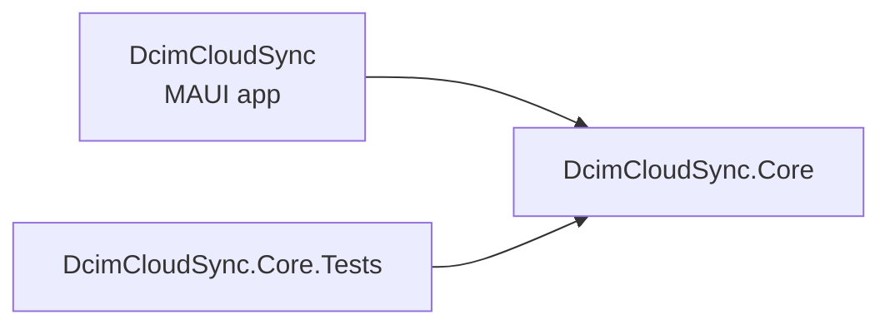

# Android DCIM Cloud Sync

Android DCIM Cloud Sync is a .NET 10 MAUI learning project for a photo and video backup application.
Android is the product platform. A Windows target exists only so services can be developed and
debugged on a workstation before they are tried on a phone. Nothing is backed up or synchronized yet.

## Current Application

The app opens one scrollable **Status** page.

- **Android 13 or later:** the page is static. The app reads no media and has no backup controls.
- **Windows (development only):** the page adds a **Media inventory** scan. The scan reads every
  photo and video in a local folder that stands in for the phone's DCIM collection, computes a
  SHA-256 hash of each file and reports the item count, bytes read, duplicates and unreadable files.
  It uploads and stores nothing.

Uploads, cloud providers, authentication, persistence, background scheduling, resume and deletion
are not implemented. Azure Blob Storage is not a usable destination in this checkout.

| Project | Purpose |
| --- | --- |
| [DcimCloudSync](src/DcimCloudSync/README.md) | MAUI application for Android, plus the Windows development target |
| [DcimCloudSync.Core](src/DcimCloudSync.Core/README.md) | Platform-neutral media contracts, folder media source and inventory scan |
| [DcimCloudSync.Core.Tests](src/DcimCloudSync.Core.Tests/README.md) | Unit tests for the core library |



## Local Development

Use a stable .NET SDK compatible with `global.json` (`10.0.403`, with `latestFeature` roll-forward
and prereleases disabled) and the .NET MAUI Android workload with its matching Android SDK and JDK.
Install the workload from an elevated prompt in the repository root so `global.json` selects the SDK:

```powershell
dotnet workload install maui-android
```

Visual Studio 2026 with MAUI tooling is the interactive development path. No Azure account or
cloud resources are needed. Build every project from the repository root:

```powershell
dotnet build .\DcimCloudSync.slnx --configuration Debug
```

On Windows this builds both the Android and Windows targets. On other operating systems, and in CI,
only the Android target is built.

### Debug on Windows

Debug services on Windows first; switch to Android only for a deliberate device test.

1. Put synthetic or copied test photos and videos in `Pictures\DcimCloudSync`. Subfolders are
   scanned. Do not use media you would not want read by development builds.
2. To use another folder, set the `DcimCloudSync__FileSystemMediaSource__RootPath` user environment
   variable, then restart Visual Studio so the app inherits it.
3. In Visual Studio, select the `net10.0-windows10.0.19041.0` framework and the **Windows Machine**
   target, then start debugging. The app runs unpackaged, without MSIX.
4. Select **Scan media**. Debug output shows the scan summary; it never includes file names or paths.

### Debug on Android

Select a compatible Android emulator or a paired device in Visual Studio and deploy interactively.
An Android emulator avoids enabling developer options on a managed phone.

### Tests

The unit tests need only the local machine: no device, Android SDK, network or cloud resources.

```powershell
dotnet test --project .\src\DcimCloudSync.Core.Tests\DcimCloudSync.Core.Tests.csproj
```

## Privacy and Platform Limits

The Android app reads no media, stores no credentials or backup state, and sends no product data
off the device. Its [Android manifest](src/DcimCloudSync/Platforms/Android/AndroidManifest.xml)
declares only:

| Permission | Scope in this checkout |
| --- | --- |
| `android.permission.INTERNET` | Allows network access; the static page makes no network requests |
| `android.permission.ACCESS_NETWORK_STATE` | Allows connectivity inspection; the static page does not inspect it |

No media, broad storage, notification or background-service permissions are declared. Android
application-data backup is disabled and cleartext traffic is disallowed. No background worker
survives closing the app.

The Windows scan reads files only from the configured folder, keeps results in memory and makes no
network requests. The Windows target is not distributed. iOS and macOS are not targeted.

See the [security policy](SECURITY.md) for vulnerability reporting.

## License

[MIT](LICENSE).
