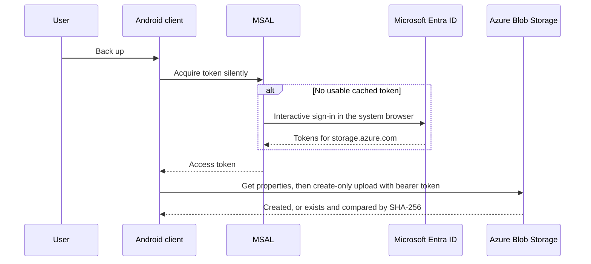

# ADR 0001: Device Credentials for Android Uploads

**Status:** Accepted.
**Date:** 2026-11-07.
**Scope:** How the Android client authorizes create-only uploads to Azure Blob Storage, and where its
non-secret destination settings come from. The Windows development target and its connection-string
configuration are out of scope.

## Context and Problem

The Android client can discover DCIM media through
[`MediaStoreMediaSource`](../src/DcimCloudSync/Platforms/Android/Services/MediaStoreMediaSource.cs), but
it cannot back up: [`AzureBlobBackupDestination`](../src/DcimCloudSync.Storage.Azure/Services/AzureBlobBackupDestination.cs)
is referenced only by the Windows target, and it authenticates with a connection string from
[`AzureBlobBackupConfig`](../src/DcimCloudSync.Storage.Azure/Models/AzureBlobBackupConfig.cs). The
[project file](../src/DcimCloudSync/DcimCloudSync.csproj) carries a TODO deferring the Android reference
until this decision exists.

A connection string embeds the account key. The [security policy](../SECURITY.md#credential-handling)
forbids long-lived storage credentials in an APK or App Bundle and requires platform-backed secure
storage for secrets. Every packaged file is public.

The intended user is a single owner backing up their own phone to a storage account they own, signing
in with an account that holds Azure role assignments in the subscription's directory, typically a personal
Microsoft account present there as an external (`#EXT#`) user.
The phone may also be enrolled in device management with a work profile.

## Goals and Constraints

- **G1** No account key, connection string or long-lived secret in the package or on the device.
- **G2** Least privilege: the device can read and create blobs in one container and cannot delete.
- **G3** Unattended operation after a first interactive sign-in, so a future scheduled backup does not
  need weekly user action.
- **G4** No hosted backend service to build, pay for or operate.
- **G5** Revocable from Azure without reinstalling or touching the device.
- **G6** Account, tenant, storage and container identifiers are entered on the device, never packaged
  or committed, because the repository and package are public.
- **Constraint:** create-only behavior stays enforced by the client's conditional upload
  (`If-None-Match: *` in `UploadBlobIfNotExistsAsync`) whatever the credential allows.
- **Constraint:** MSAL.NET on Android keeps its token cache in app-private shared preferences and rejects
  custom cache serialization on mobile platforms, so tokens cannot be moved into MAUI `SecureStorage`.
- **Non-goals:** multiple users or devices sharing an account, other providers, and the Windows target.

## Options Considered

| Option | Benefits | Costs and risks | Assessment |
| --- | --- | --- | --- |
| Keep the current design (connection string) | Already implemented on Windows | Embeds the account key; violates the security policy and G1 | Rejected |
| A. Microsoft Entra sign-in on the device with MSAL and a custom no-delete role | No backend (G4); no stored secret beyond the MSAL token cache (G1); silent refresh (G3); revoke by removing the role assignment or the user's sessions (G5); Microsoft's recommended authorization for Blob Storage | Azure-side `write` also permits overwrite, so create-only rests on the client's conditional upload; needs an app registration; work-profile broker interaction must be avoided | **Accepted** |
| B. Paste a long-lived create-and-read service SAS | Simplest client; the `c` permission makes Azure itself refuse overwrites | A long-lived bearer secret on the device; revocation needs a stored access policy signed with the account key, which Microsoft discourages | Rejected: G1 |
| C. Paste a user delegation SAS | Azure enforces create-only; short-lived | The signing key lasts at most seven days, so backup stops without weekly manual renewal | Rejected: G3 |
| D. Backend issues short-lived create-only SAS tokens | Strongest least privilege; Azure enforces create-only | A hosted service, identity flow and operations for a single-user app | Rejected: G4; reconsider for multiple users |

## Decision

Authorize Android uploads with a Microsoft Entra access token for Azure Storage, acquired on the device
through MSAL.NET as a public client, and limit the signed-in user to a custom role on one container.

- **Identity:** an app registration in the directory that owns the subscription, as a single-tenant
  public client whose only redirect URI is `io.github.f2calv.androiddcimcloudsync://auth`, a fixed
  scheme because the client ID is entered on the device rather than compiled into the manifest. The owner's personal Microsoft account signs in to that directory
  as a member, with the authority set to the directory's tenant ID rather than `consumers` or `common`.
- **Token:** MSAL acquires the delegated scope `https://storage.azure.com/user_impersonation`; a small
  `TokenCredential` adapter hands MSAL tokens to the Azure SDK. MSAL tries silent acquisition first and
  falls back to interactive sign-in in the system browser.
- **Broker:** the client does not enable the authentication broker, so a device-management broker on a
  work profile cannot substitute a work account.
- **Authorization:** a custom role with the blob `read`, `add/action` and `write` data actions, without
  delete, version deletion, moves or tags, assigned to the owner at the container scope. `add/action`
  alone creates new blobs, but Put Block and Put Block List, which large videos need, require `write`.
  Container creation stays outside the device's rights. The owner consents to the storage scope once,
  through a delegated permission grant, so sign-in shows no consent prompt.
- **Destination:** the Azure provider gains a constructor taking a `TokenCredential` and container URI
  through the existing non-provisioning `AzBlobStorageBase(BlobContainerClient)` path, so construction
  performs no network I/O and the connection-string path remains Windows-only.
- **Settings:** tenant ID, client ID, blob service endpoint, container and prefixes are entered on a
  settings page and kept in MAUI `Preferences`; none are secrets, but none are packaged or committed.
  The MSAL token cache is the only credential material on the device; it lives in app-private storage,
  covered by the app sandbox, file-based encryption and `android:allowBackup="false"`, not keystore
  encryption.
- **Enforcement:** Azure RBAC enforces read/write/no-delete; the client enforces create-only and hash
  verification; Entra enforces sign-in, token lifetime and revocation.

## Consequences

- Positive: no secret is packaged or pasted; revocation and sign-in policy live in Entra; the same
  backup service, hash verification and outcomes run on Android as on Windows.
- Negative: overwrite protection is client-enforced, not Azure-enforced, because RBAC `write` covers
  both creating and replacing. A compromised device token could overwrite blobs until revoked; it still
  cannot delete. Enable blob versioning or soft delete on the account if that risk matters; the owner's
  deployment enables 30-day blob and container soft delete.
- Negative: the owner maintains an app registration and a custom role definition, and must sign in
  again when the refresh token expires or is revoked. The owner manages them as infrastructure as code
  in a private repository, applied by an operator account because they need directory permissions.
- Negative: refresh tokens are not keystore-encrypted; a rooted or compromised device can read them.
  Revoke the user's sessions in Entra if the phone is lost.
- Failure handling: an expired or revoked sign-in surfaces as an authorization failure that stops the
  run, and is never treated as transient; the next foreground run prompts for sign-in.
- Rollback: remove the role assignment or the app registration; the device then fails closed. The
  Windows connection-string path is unaffected.

## Validation and Delivery

- **V1** The custom role allows Get Blob Properties and Put Blob for new names, and a Delete Blob attempt
  with the same token returns 403.
- **V2** A personal Microsoft account signs in through MSAL with the directory tenant authority on the
  emulator, and a backup run uploads synthetic media with `sha256` metadata matching the source files,
  including a photo with EXIF location, proving original bytes reach the blob.
- **V3** Restarting the app performs a silent token acquisition with no prompt.
- **V4** Removing the role assignment makes the next run fail with an authorization message and no
  partial blobs.
- **V5** The package, repository and logs contain no tenant, client, account or container identifiers,
  and no tokens; the repository privacy scans pass.

Progress on 2026-11-07, against a dedicated test container on the emulator:

- **V1 observed:** creating a new blob and reading its properties succeeded with the owner's account,
  and deleting it was refused.
- **V2 observed:**
  - the owner's personal Microsoft account signed in as a B2B guest through the system browser;
  - all 13 synthetic items were uploaded, and each blob's `sha256` metadata matched its source file;
  - the photo with EXIF location downloaded byte-identical, with its GPS block intact.
- **V3 observed:** after the app process was killed, a WorkManager-started process acquired a token
  silently from the persisted cache, with no prompt.
- **V5 observed:**
  - the repository privacy scan found nothing;
  - the working tree and the emulator log contained none of the test tenant, account, storage account
    or container identifiers, and no bearer tokens;
  - the package carries no identifiers, because they are entered on the device.
- **V4 observed:**
  - after a targeted Terraform destroy removed the role assignment, **Back up** stopped with "Azure
    Blob Storage rejected a backup lookup with status 403";
  - no blob was created, since the lookup fails before any upload;
  - re-applying restored the assignment, and a follow-up plan showed no changes.

Delivery is one branch: the credential adapter and destination constructor, the settings page,
Android registration of the backup service, then validation V1-V5 on the emulator. Background backup
followed on the same branch: background runs only acquire tokens silently and notify the user when
sign-in is needed (see the [app README](../src/DcimCloudSync/README.md#background-backup)).

## Open Questions and Reconsideration

- Resolved: MSAL.NET stores its Android cache in app-private shared preferences, and its token cache
  rejects custom serialization on mobile platforms; the residual risk is recorded under Consequences.
- Resolved: `blobs/add/action` grants create-without-overwrite for Put Blob, but block uploads need
  `write`, so Azure cannot enforce create-only for large files and the client keeps that duty.
- Reconsider option D if more than one person or device needs access, or if Azure-enforced create-only
  becomes a requirement for every file size.

## Evidence and Related Decisions

| Evidence | Relevance |
| --- | --- |
| [Create a user delegation SAS](https://learn.microsoft.com/en-us/rest/api/storageservices/create-user-delegation-sas) | `c` writes only new blobs while `w` can replace them; a user delegation key lasts at most seven days; Microsoft recommends Entra over account keys |
| [Authorize access to blobs using Microsoft Entra ID](https://learn.microsoft.com/en-us/azure/storage/blobs/authorize-access-azure-active-directory) | Entra authorization and RBAC data actions for Blob Storage |
| [Azure custom roles](https://learn.microsoft.com/en-us/azure/role-based-access-control/custom-roles) | Defining a role without the delete data action |
| [Put Blob](https://learn.microsoft.com/en-us/rest/api/storageservices/put-blob) and [Put Block List](https://learn.microsoft.com/en-us/rest/api/storageservices/put-block-list) | `add/action` creates new block blobs; `write` is needed to overwrite and for block uploads |
| [MSAL.NET Android token cache accessor](https://github.com/AzureAD/microsoft-authentication-library-for-dotnet/blob/main/src/client/Microsoft.Identity.Client/Platforms/Android/AndroidTokenCacheAccessor.cs) | Tokens persist in app-private shared preferences |
| [Authenticate users with MSAL.NET in .NET MAUI](https://learn.microsoft.com/en-us/dotnet/maui/data-cloud/authentication?view=net-maui-10.0) | MSAL.NET public-client sign-in on Android |
| [`AzureBlobBackupDestination`](../src/DcimCloudSync.Storage.Azure/Services/AzureBlobBackupDestination.cs) | Current connection-string destination and create-only upload |
| [`IBackupDestination`](../src/DcimCloudSync.Core/Abstractions/IBackupDestination.cs) | Provider-neutral contract the Android destination must keep |
| [Security policy](../SECURITY.md#credential-handling) | Prohibits packaged long-lived credentials |
