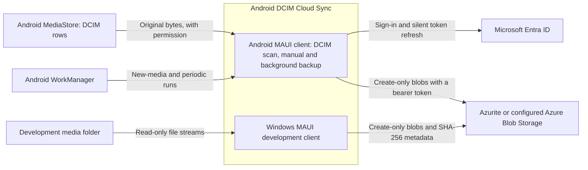
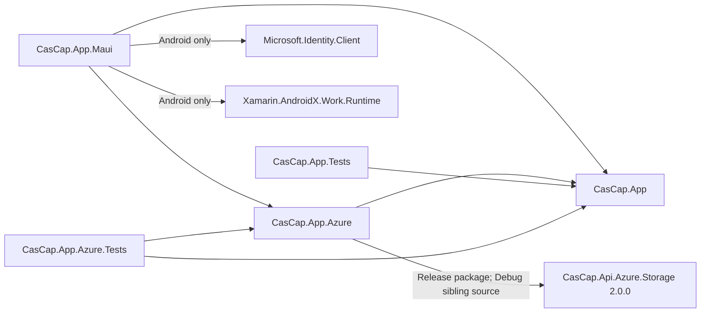
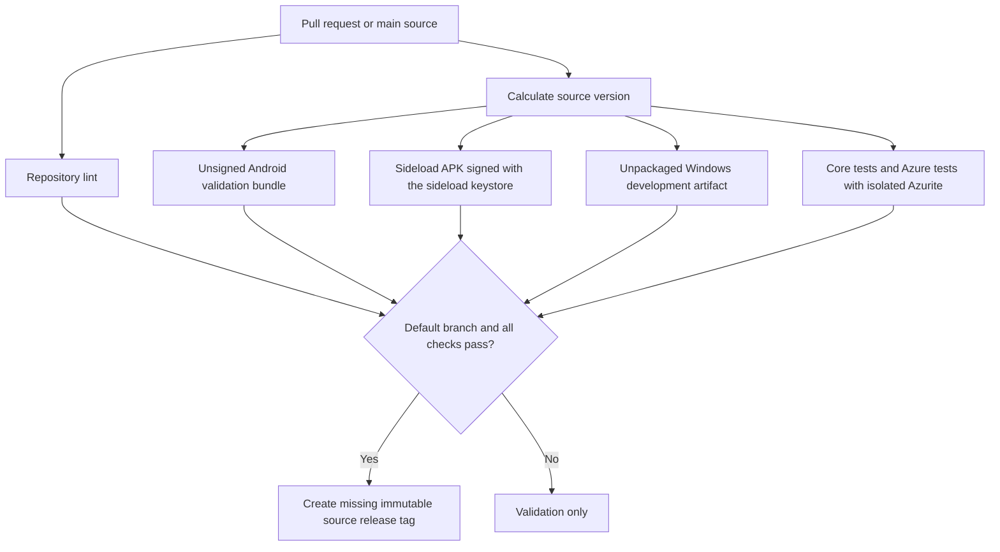

# Architecture

Android is the product platform: it scans DCIM media through MediaStore and backs it up after a Microsoft
sign-in. Windows provides a development-only media scan and backup client.
The [System Context](../README.md#system-context) describes that boundary.

## Containers

The clients run separately. Android authorizes uploads with an Entra access token and a no-delete role,
as decided in [ADR 0001](adr-0001-device-credentials.md), and shows backup controls once its settings
are saved. While automatic backup is on, WorkManager also starts background runs when DCIM media
changes and every six hours on unmetered networks; they back up only items changed since the last
complete run and never prompt for sign-in. Windows activates backup controls only when a destination
connection string is configured.

## Dependency Graph

The [Azure provider project](../src/CasCap.App.Azure/CasCap.App.Azure.csproj)
owns SDK integration. Provider-neutral contracts remain in the core library. None of these projects
publishes a NuGet package.

## Backup Flow

The [core README](../src/CasCap.App/README.md#contracts-and-services) owns the scan and backup
flow diagrams. The upload stream verifies its SHA-256 at end-of-stream before the destination can
commit. Existing blobs are never overwritten; matching, conflicting, unverified and changed content
have distinct outcomes. A rerun checks the destination again rather than relying on a local queue;
Android background runs keep only a MediaStore change checkpoint to skip unchanged items.

## Validation Flow

The [CI workflow](../.github/workflows/ci.yml) delegates platform builds to the released shared
workflows. The sideload APK is signed with the sideload keystore from repository secrets. It is skipped for Dependabot and fork pull requests, which receive no secrets.
Windows and APK artifacts have a 14-day retention period and are not attached to releases. No device
deployment, release signing or Play publication is enabled. Both test projects run in the shared
.NET build workflow; only the Azure test job provisions disposable Azurite storage. The release
fan-in includes both test jobs and the APK build. Azurite tests cover conditional writes and changed content, not a
live Azure account or device.
