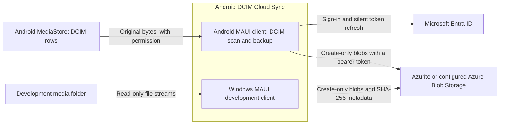
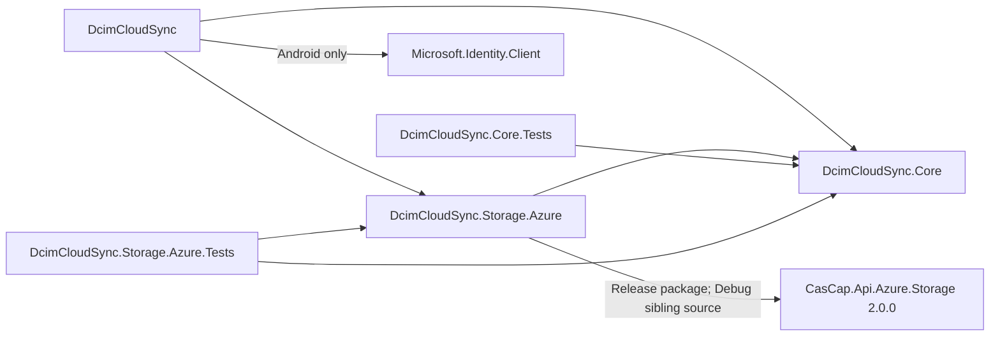
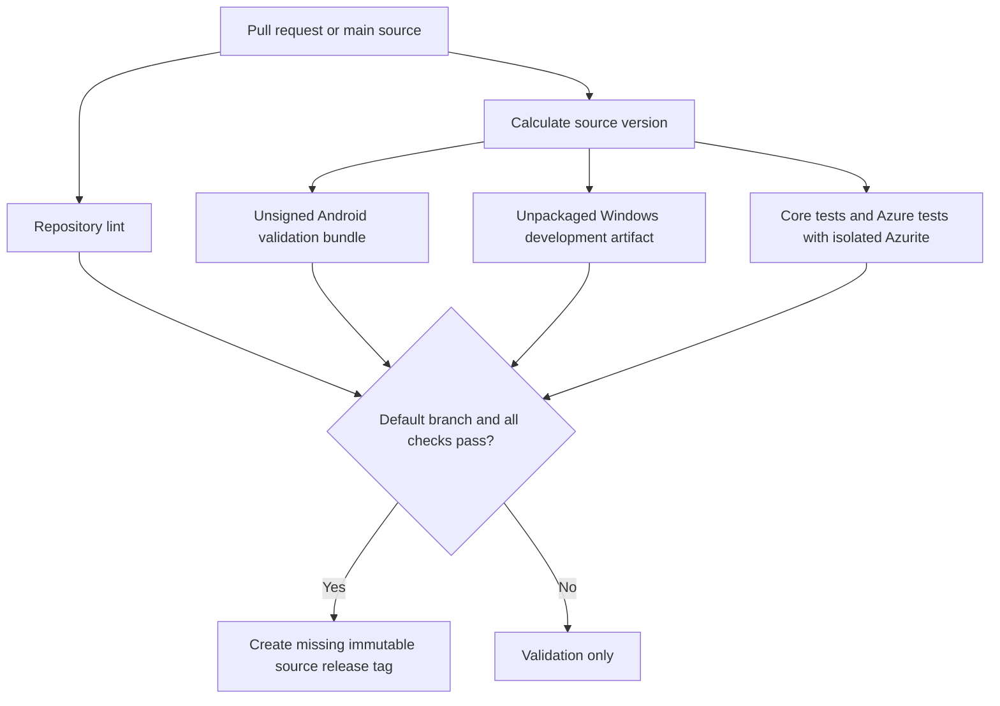

# Architecture

Android is the product platform: it scans DCIM media through MediaStore and backs it up after a Microsoft
sign-in. Windows provides a development-only media scan and backup client.
The [System Context](../README.md#system-context) describes that boundary.

## Containers

The clients run separately. Android authorizes uploads with an Entra access token and a no-delete role,
as decided in [ADR 0001](adr-0001-device-credentials.md), and shows backup controls once its settings
are saved. Windows activates backup controls only when a destination connection string is configured.

## Dependency Graph

The [Azure provider project](../src/DcimCloudSync.Storage.Azure/DcimCloudSync.Storage.Azure.csproj)
owns SDK integration. Provider-neutral contracts remain in the core library. None of these projects
publishes a NuGet package.

## Backup Flow

The [core README](../src/DcimCloudSync.Core/README.md#contracts-and-services) owns the scan and backup
flow diagrams. The upload stream verifies its SHA-256 at end-of-stream before the destination can
commit. Existing blobs are never overwritten; matching, conflicting, unverified and changed content
have distinct outcomes. A rerun checks the destination again rather than relying on a local queue.

## Validation Flow

The [CI workflow](../.github/workflows/ci.yml) delegates platform builds to the released shared
workflows. Windows artifacts have a 14-day retention period and are not attached to releases.
No device deployment, signing or Play publication is enabled. Both test projects run in the shared
.NET build workflow; only the Azure test job provisions disposable Azurite storage. The release
fan-in includes both test jobs. Azurite tests cover conditional writes and changed content, not a
live Azure account or device.
