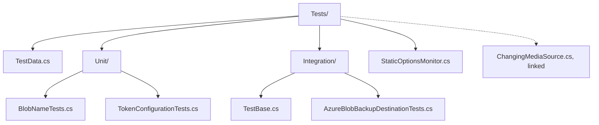

# DcimCloudSync.Storage.Azure.Tests

xUnit v3 tests for [DcimCloudSync.Storage.Azure](../DcimCloudSync.Storage.Azure/README.md), running on
Microsoft.Testing.Platform.

## Tests

| Class | Category | Methods | Test cases | Needs |
| --- | --- | --- | --- | --- |
| [`BlobNameTests`](Tests/Unit/BlobNameTests.cs) | `Naming` | 1 | 4 | Nothing |
| [`TokenConfigurationTests`](Tests/Unit/TokenConfigurationTests.cs) | `Configuration` | 4 | 10 | Nothing |
| [`AzureBlobBackupDestinationTests`](Tests/Integration/AzureBlobBackupDestinationTests.cs) | `Integration` | 5 | 5 | Azurite or a configured account |
| **Total** | | **10** | **19** | |

- `Naming` checks photo and video prefixes, trimmed and empty prefixes.
- `Configuration` checks that exactly one of a connection string or an https blob service URL is set,
  `IsConfigured` for each, and that the token credential adapter passes scopes and tokens through.
- `Integration` checks create-only uploads, recorded hashes, content types and access tiers, the error for
  a missing container, an item changed after hashing leaving no blob behind, and a backup run over a
  temporary folder: first upload, rerun, then a changed file reported as a conflict. The changing
  item comes from `ChangingMediaSource`, linked from the core test project.

## Skipped Tests

The 5 `Integration` cases skip, with a message naming the start command, when Azurite is not reachable
on `127.0.0.1:10000`. No test is skipped unconditionally.

## Running

Unit tests only:

```powershell
dotnet test --project .\src\DcimCloudSync.Storage.Azure.Tests\DcimCloudSync.Storage.Azure.Tests.csproj --filter-not-trait Category=Integration
```

With the integration tests, after starting Azurite from the repository root:

```powershell
docker compose up -d --wait azurite
dotnet test --project .\src\DcimCloudSync.Storage.Azure.Tests\DcimCloudSync.Storage.Azure.Tests.csproj
```

The connection string defaults to Azurite. Setting `DcimCloudSync__AzureBlobBackup__ConnectionString`
targets another account; use only a disposable test account. Each test creates its own
`test-<guid>` container and deletes it afterwards, so existing data is never touched.

## Layout



## Dependencies

| Reference | Use |
| --- | --- |
| [DcimCloudSync.Storage.Azure](../DcimCloudSync.Storage.Azure/README.md) | System under test |
| [DcimCloudSync.Core](../DcimCloudSync.Core/README.md) | Folder media source and backup service for the lifecycle test |
| `xunit.v3` `4.0.2` | Test framework |
