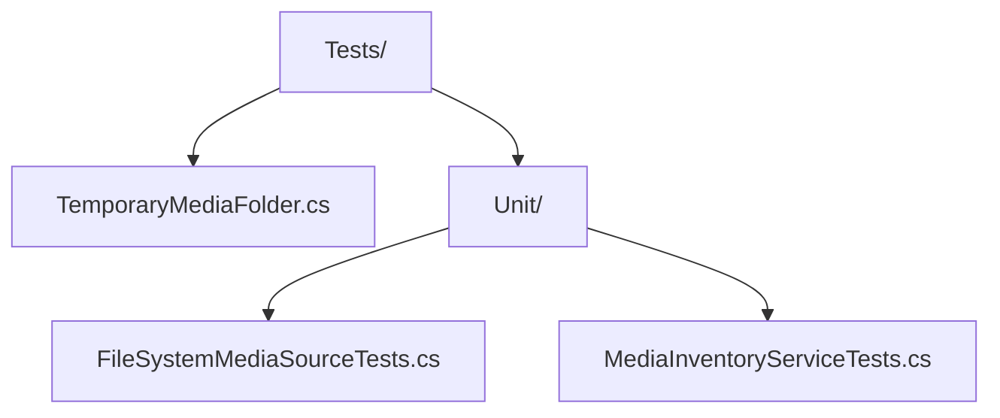

# DcimCloudSync.Core.Tests

xUnit v3 unit tests for [DcimCloudSync.Core](../DcimCloudSync.Core/README.md), running on
Microsoft.Testing.Platform. They need no device, Android SDK, network or cloud resources. Each test
creates its own temporary folder of small synthetic text files with media extensions and deletes it
afterwards.

```powershell
dotnet test --project .\src\DcimCloudSync.Core.Tests\DcimCloudSync.Core.Tests.csproj
```

## Tests

| Class | Category | Methods | Test cases |
| --- | --- | --- | --- |
| [`FileSystemMediaSourceTests`](Tests/Unit/FileSystemMediaSourceTests.cs) | `Discovery` | 4 | 5 |
| [`MediaInventoryServiceTests`](Tests/Unit/MediaInventoryServiceTests.cs) | `Hashing` | 3 | 3 |
| **Total** | | **7** | **8** |

The trait categories are `Discovery`, for finding and opening folder media, and `Hashing`, for scan
summaries, duplicates, unreadable files and cancellation. `ScanAsync_UnreadableItem` makes a file
unreadable by holding it open with `FileShare.None`.

## Skipped Tests

None.

## Layout



## Dependencies

| Package | Version |
| --- | --- |
| `xunit.v3` | `4.0.2` |

| Project reference | Use |
| --- | --- |
| [DcimCloudSync.Core](../DcimCloudSync.Core/DcimCloudSync.Core.csproj) | System under test |
