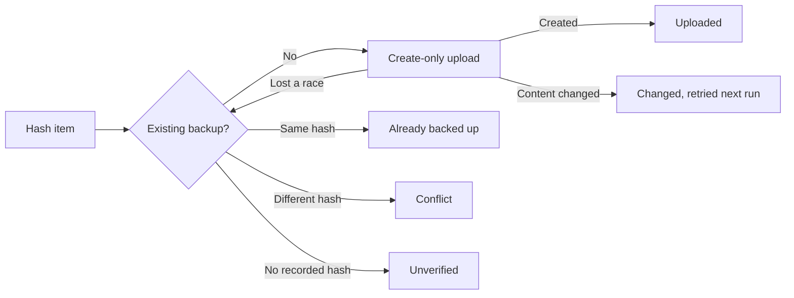

# DcimCloudSync.Core

Platform-neutral contracts and services for Android DCIM Cloud Sync. The library has no MAUI,
Android or Azure dependency, so it can be developed and tested on any workstation.

## Contracts and Services

| Type | Responsibility |
| --- | --- |
| [`IMediaSource`](Abstractions/IMediaSource.cs) | Discovers photos and videos and opens each as a caller-owned read-only stream |
| [`IChangeTrackingMediaSource`](Abstractions/IChangeTrackingMediaSource.cs) | A media source that issues an opaque change token and lists only items changed since one |
| [`IBackupCheckpointStore`](Abstractions/IBackupCheckpointStore.cs) | Persists the change token of the last complete backup run |
| [`MediaItem`](Models/MediaItem.cs) | Source identity, relative path, display name, MIME type, size and modification time of one item |
| [`IMediaAccess`](Abstractions/IMediaAccess.cs), [`MediaAccessStatus`](Models/MediaAccessStatus.cs) | Requests media permission, or checks it without prompting, and reports full, partial or denied access and whether location is kept |
| [`IAccessTokenProvider`](Abstractions/IAccessTokenProvider.cs), [`AccessTokenResult`](Models/AccessTokenResult.cs) | Provider-neutral signed-in token acquisition and sign-out; the token never appears in `ToString` |
| [`InteractiveSignIn`](Services/InteractiveSignIn.cs) | Suppresses sign-in prompts within an asynchronous flow, for unattended runs |
| [`UnrestrictedMediaAccess`](Services/UnrestrictedMediaAccess.cs) | Reports full access for sources without a permission model |
| [`MediaStoreItemPath`](Services/MediaStoreItemPath.cs) | Maps Android MediaStore rows to DCIM-relative paths and source identities, without Android types |
| [`FileSystemMediaSource`](Services/FileSystemMediaSource.cs) | `IMediaSource` over a local folder, standing in for Android MediaStore during development |
| [`MediaInventoryService`](Services/MediaInventoryService.cs) | Streams and SHA-256 hashes every discovered item, reporting progress and a summary |
| [`MediaInventoryProgress`](Models/MediaInventoryProgress.cs) | Items processed and bytes read so far |
| [`MediaInventorySummary`](Models/MediaInventorySummary.cs) | Item count, bytes read, duplicates, unreadable items and elapsed time |
| [`IBackupDestination`](Abstractions/IBackupDestination.cs) | Finds an item's backup and creates one only when none exists |
| [`BackupService`](Services/BackupService.cs) | Hashes each item, compares it with its backup and uploads only missing items; runs one at a time, in full or from the last checkpoint |
| [`BackupRecord`](Models/BackupRecord.cs), [`BackupProgress`](Models/BackupProgress.cs), [`BackupSummary`](Models/BackupSummary.cs), [`BackupItemOutcome`](Models/_Enums.cs) | Existing backup hash, run progress, run summary and per-item outcome |
| [`BackupDestinationException`](Exceptions/BackupDestinationException.cs) | Provider-neutral destination failure; its message holds no item names, paths or endpoints |
| [`SignInRequiredException`](Exceptions/SignInRequiredException.cs) | Destination failure that needs the user to sign in, because no prompt could be shown |
| [`MediaChangedException`](Exceptions/MediaChangedException.cs) | Item content changed after hashing; raised by the upload stream before anything is committed |

`FileSystemMediaSource` recurses through subfolders and skips hidden and system files, inaccessible
folders and files without a known photo or video extension. It uses each item's relative path,
with `/` separators, as its source identity and rejects any item that resolves outside the
configured folder. A missing folder raises `DirectoryNotFoundException` without the path in its
message.

`MediaInventoryService` counts an item as unreadable when opening or reading it raises an
`IOException` or `UnauthorizedAccessException`, then continues with the next item. Duplicates are
counted within one scan by comparing hashes; nothing is persisted. Cancellation stops discovery
and the current read.

`BackupService` reads each item twice: once to hash it, then to upload it when no backup exists.
It never overwrites or deletes. The destination decides each outcome:

Because the destination is the record of what is backed up, an interrupted run resumes by
skipping items that already match, with no per-item local state. Unreadable items are counted and skipped;
a `BackupDestinationException` stops the run.

Runs are serialized by one lock, so a run started during another waits for it. When the source
implements `IChangeTrackingMediaSource` and a checkpoint store is registered, every run takes a change
token before discovery and saves it when no item was unreadable. `BackUpChangesAsync` then lists only
items changed since that token, or every item when none is saved; `BackUpAsync` always lists every item.
An unreadable item keeps the previous checkpoint, so it is listed again next time.

The upload stream re-hashes the content as the destination reads it. If the item changed after it
was hashed, the read that reaches the end throws `MediaChangedException` before the destination can
commit, so no backup with a mismatched hash is created. The item is counted as changed and retried
by the next run. Destinations must therefore read the content to its end before committing.

Item names and paths can identify a person, so logs contain only counts, item ordinal numbers,
outcomes, byte lengths and exception type names.

## Configuration

[`FileSystemMediaSourceConfig`](Models/FileSystemMediaSourceConfig.cs) binds the
`FileSystemMediaSource` section:

| Key | Default | Validation |
| --- | --- | --- |
| `RootPath` | `DcimCloudSync` inside the user's Pictures folder | Required, non-empty |

The library defines no configuration provider; the host binds the section.

## Dependencies

| Package | Version | Use |
| --- | --- | --- |
| `Microsoft.Extensions.Logging.Abstractions` | `10.0.14` | `ILogger` and source-generated log messages |
| `Microsoft.Extensions.Options` | `10.0.14` | `IOptions` access to the media source configuration |

The [Azure destination](../DcimCloudSync.Storage.Azure/README.md) implements `IBackupDestination`.

The project has no project references and is not packable.
